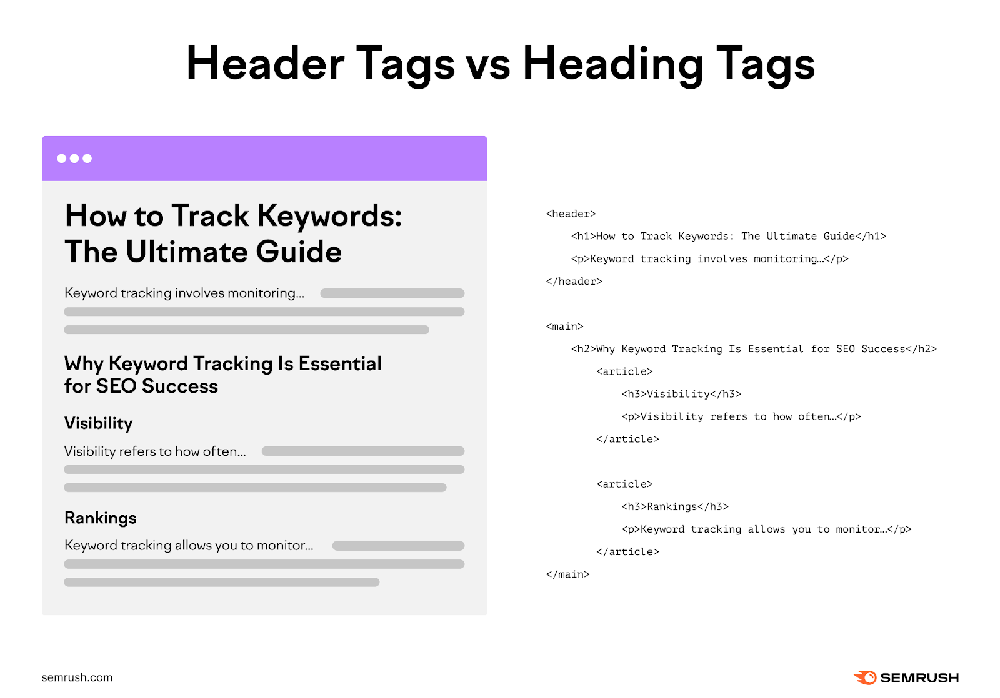
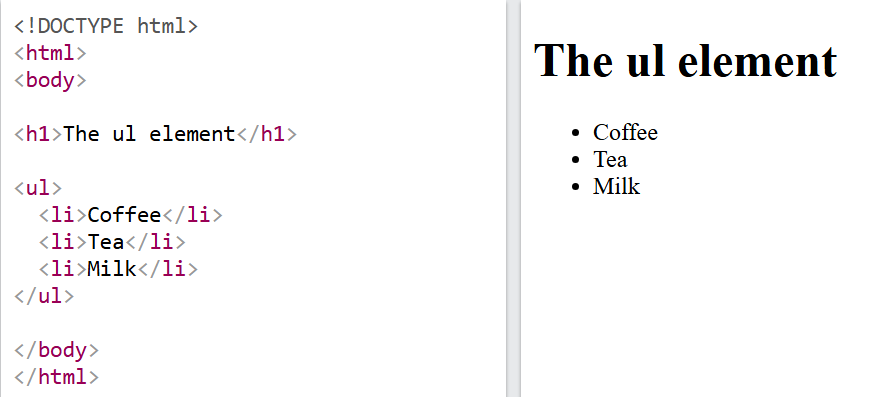
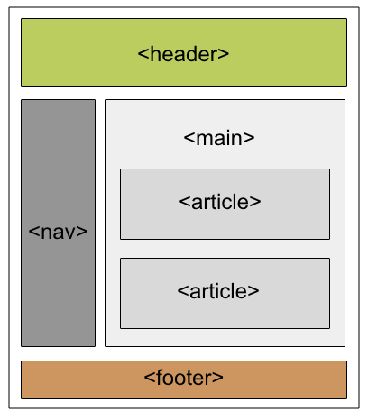
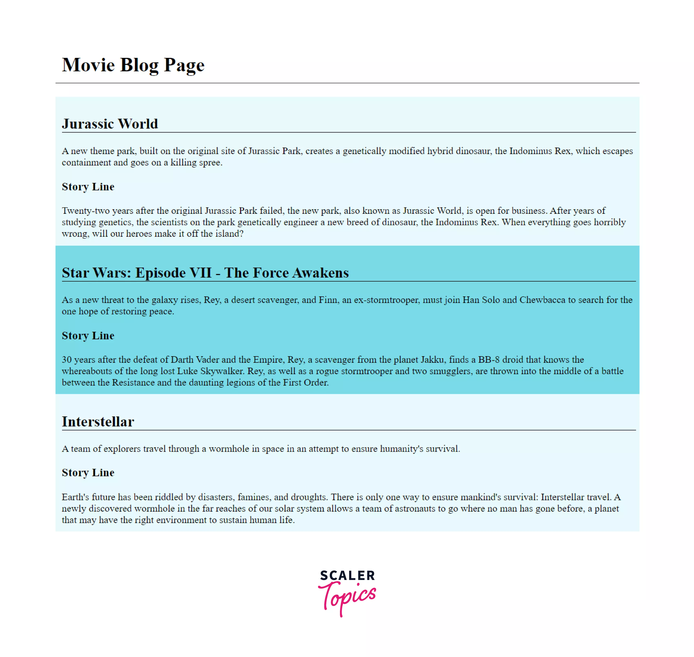
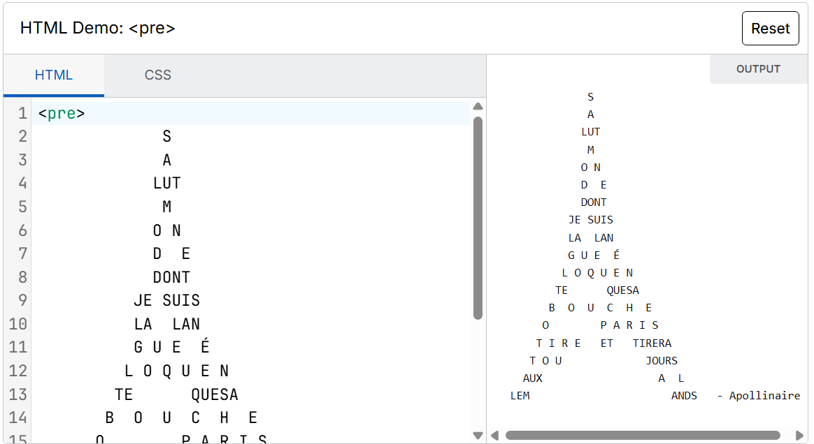

# HTML 

## Mit jelent az, hogy szemantikus HTML?

A HTML-ben az elemek nemcsak a tartalmat fogják közre, hanem sokszor azt is megmondják, **milyen szerepet tölt be a tartalom**. Ezeket nevezzük *szemantikus elemeknek*.

Például egy `<div>` önmagában nem árulja el, mire szolgál, míg a `<nav>` azt jelzi, hogy navigációs részről, a `<footer>` pedig azt, hogy láblécről van szó. Ez a böngészőknek, a képernyőolvasóknak és a kódot később olvasó fejlesztőknek is hasznos.

Ebben a feladatban főként a **`header`, `nav`, `main`, `article` és `footer`** elemekkel dolgozunk, valamint megnézzük a bennük használt további HTML-elemeket. **Fontos:** a szemantikus elemek elsősorban a *jelentést és a szerkezetet* adják meg, nem azt, hogy egy terület pontosan hol vagy milyen színnel jelenjen meg. Az elrendezésről és a formázásról általában CSS gondoskodik.

---

## A `head` elem 

A `<head>` a HTML-dokumentumra vonatkozó **metaadatokat és beállításokat** tartalmazza. Tartalma rendszerint nem jelenik meg az oldal szöveges tartalmaként.

```html
<head>
    <meta charset="UTF-8">
    <title>Webtechnológiák</title>
    <link rel="stylesheet" href="web-technologies.css">
</head>
```

- `<meta charset="UTF-8">`: megadja a karakterkódolást, hogy például az ékezetes betűk helyesen jelenjenek meg.
- `<title>`: a böngészőfül címe, **nem** az oldal látható főcíme.
- `<link rel="stylesheet" ...>`: külső CSS-fájlt kapcsol a dokumentumhoz. A `href` itt a fájl elérési útját adja meg.

**Ne keverjük össze:** a `<head>` a *dokumentum adatait* tartalmazza, a `<header>` pedig a *látható tartalom egyik része*.

---

## A `header` elem és a címsorok (`h1`–`h6`)

A `<header>` egy oldal vagy egy önálló tartalmi egység **bevezető, fejlécjellegű részét** jelöli. Gyakran itt találjuk a címet, egy rövid leírást vagy a közzététel dátumát.

```html
<header>
    <h1>Webtechnológiák</h1>
    <p>Bevezetés a webes szabványokba.</p>
</header>
```
## A `<time>` elem és a `datetime` attribútum

A `<time>` elem **dátumok és időpontok megjelölésére** szolgál.

Például:

```html
<p>Utolsó módosítás: <time datetime="2026-10-09">2026. október 9.</time></p>
```

A böngészőben a `<time>` elem tartalma jelenik meg:

```text
Utolsó módosítás: 2026. október 9.
```

De **miért van szükség a `datetime` attribútumra**, ha egyszer a dátum már szövegként is szerepel?

Tegyük fel, hogy egy másik weboldalon így írjuk ki:

```html
<time datetime="2026-10-09">október kilencedikén</time>
```

A látogató számára ez teljesen érthető, de egy programnak már nehezebb lenne felismernie és feldolgoznia.

A `datetime` attribútumnak köszönhetően JavaScriptből egyszerűen lekérhetjük a szabványos formában tárolt dátumot:

```javascript
const date = document.querySelector("time").dateTime;

console.log(date); // 2026-10-09
```

Így például egy program meg tudja állapítani, hogy egy bejegyzés mikor jelent meg, mennyi idő telt el azóta, vagy időrendbe tudja rendezni a bejegyzéseket.

**Tehát a lényeg:**

- A `<time>` elemen belüli szöveg az **olvasónak szól**, és tetszőlegesen megfogalmazható.
- A `datetime` attribútum a **programok számára értelmezhető dátumot vagy időpontot** tartalmazza.

A `datetime` attribútum megadása nem kötelező minden esetben, de különösen hasznos, ha a megjelenített dátum nem szabványos formátumú.
A `header` **nem ugyanaz, mint a `h1` vagy a `h2`**:

- `<header>`: összefogja a bevezető tartalmat;
- `<h1>`: a legmagasabb szintű címsor;
- `<h2>`: egy nagyobb fejezet címe;
- `<h3>`: azon belüli alfejezet címe (és így tovább `h6`-ig).

Például:

```html
<h1>Webtechnológiák</h1>
<h2>HTML</h2>
<h3>Specifikációk</h3>
```

A címsorok **hierarchiát** fejeznek ki, nem egyszerűen különböző betűméreteket. A méretüket CSS-sel is módosíthatjuk.



*A képen a `header` egy bevezető szakaszt fog össze, miközben a `h1`, `h2` és `h3` a szöveg címeinek szintjeit jelölik. A színek és az elrendezés a szemléltetés részei, nem a `header` kötelező kinézete.*

---

## A `p` elem – bekezdés

A `<p>` (*paragraph*) egy szöveges bekezdést jelöl.

```html
<p>A HTML a weboldalak tartalmának és szerkezetének leírására szolgál.</p>
<p>A CSS a megjelenést szabályozza.</p>
```

A böngésző ezeket két külön bekezdésként jeleníti meg. A `<p>` tehát nem csak egy sortörés: **önálló bekezdést** hoz létre.


---

## A `nav` elem – navigáció

A `<nav>` az oldal **fontos navigációs hivatkozásait** fogja össze, például egy menüt vagy tartalomjegyzéket.

```html
<nav>
    <h2>Tartalomjegyzék</h2>
    <ul>
        <li><a href="#json">JSON</a></li>
        <li><a href="#css">CSS</a></li>
        <li><a href="#html">HTML</a></li>
    </ul>
</nav>
```

### `ul` és `li` – felsorolás

- `<ul>` (*unordered list*): nem számozott felsorolást tartalmaz; alapértelmezetten felsorolásjelekkel jelenik meg.
- `<li>` (*list item*): a felsorolás egyetlen eleme.

```html
<ul>
    <li>HTML</li>
    <li>CSS</li>
    <li>JavaScript</li>
</ul>
```



*Az `ul` fogja össze a listát, a `li` elemek pedig külön-külön sorolják fel a tételeket.*

### `a` és `href` – hivatkozás

Az `<a>` (*anchor*) egy kattintható hivatkozást hoz létre. A `href` attribútum megadja, **hová vezessen a hivatkozás**.

```html
<a href="https://html.spec.whatwg.org/">HTML-szabvány</a>
```

Az oldal **saját részeire** is hivatkozhatunk:

```html
<a href="#css">Ugrás a CSS-részhez</a>

<article id="css">
    <h2>CSS</h2>
</article>
```

A `#css` a dokumentumban található `id="css"` azonosítójú elemhez navigál. Így működhet például a tartalomjegyzék.

---

## A `main` elem – az oldal fő tartalma

Eddig van egy **`header`** fejlécünk és egy **`nav`** navigációs részünk. A ténylegesen feldolgozandó tartalomhoz a `<main>` elemet használjuk.

```html
<body>
    <header>...</header>
    <nav>...</nav>

    <main>
        <!-- Az oldal fő tartalma -->
    </main>
</body>
```

A `<main>` az oldal **elsődleges, egyedi tartalmát** fogja össze, tehát például a témák ismertetését. Nem a közös menü vagy a lábléc helye.



*Az ábra a részek szerepét mutatja. Attól, hogy `nav` és `main` elemeket használunk, még nem kerülnek automatikusan egymás mellé: ehhez CSS-elrendezés szükséges.*

### Az `article` elem – önálló tartalmi egység

A `<main>` belsejében több, **önmagában is értelmezhető tartalmi egység** helyezkedhet el. Ilyenek lehetnek például a feladatban a JSON, a CSS és a HTML bemutatásai.

```html
<main>
    <article id="json">
        <h2>JSON</h2>
        <p>Adatok cseréjére használható szöveges formátum.</p>
    </article>

    <article id="css">
        <h2>CSS</h2>
        <p>A dokumentumok megjelenését szabályozza.</p>
    </article>
</main>
```


Az `article` tehát nem tetszőleges díszítődoboz: akkor jó választás, ha a benne lévő tartalom **külön egységként is megállja a helyét**.

---

## A `pre` elem – előre formázott szöveg

A `<pre>` (*preformatted text*) **megőrzi a szövegben lévő szóközöket és sortöréseket**. Ezért hasznos például kódok, ASCII-ábrák vagy más, pontos térközöket igénylő szövegek megjelenítéséhez.

```html
<pre>Első sor
    Behúzott sor
Harmadik sor</pre>
```

A középső sor behúzása a böngészőben is megmarad.



*Az ábrán a szóközök és a sortörések megtartása teszi lehetővé az eredeti elrendezés megőrzését.*

**Figyelem:** ha a `<pre>` belsejében a HTML-forrásban behúzzuk a sorokat, az a megjelenítésben is látszik. Forráskódok szemantikus jelölésére a `<pre>` elemen belül `<code>` is használható. Ha HTML-kódot szeretnénk szövegként mutatni, a `<` jelet például `&lt;` formában kell írni, különben a böngésző elemnyitásként értelmezheti.

---

## A `footer` elem – lábléc

A `<footer>` egy oldal vagy egy tartalmi egység **lezáró, láblécjellegű információit** fogja össze. Itt szokás megadni például a szerzőt, a kapcsolati adatokat vagy a felhasználási feltételeket.

```html
<footer>
    <p>Az oldal tartalma Creative Commons licenc alatt érhető el.</p>
</footer>
```


*A `footer` szemantikus szerepe a lábléc megjelölése; a képen látható színt és elhelyezést CSS-sel lehet kialakítani. A `footer` nem válik automatikusan a képernyő aljára rögzített elemmé.*

### A `small` elem – kiegészítő, apróbetűs információ

A `<small>` például jogi megjegyzésekhez, szerzői jogi vagy licencinformációhoz használható. A böngészők alapértelmezetten kisebb betűvel jelenítik meg.

```html
<small>Ez a tartalom CC BY 4.0 licenc alatt használható fel.</small>
```

### Az `img` elem – kép

Az `` egy képet jelenít meg. Nincs külön záró `</img>` címkéje.

```html

```

- **`src`** (*source*): a kép elérési útja vagy URL-címe. Ez alapján tölti be a böngésző a képet.
- **`alt`** (*alternative text*): rövid szöveges helyettesítés, amely leírja a kép lényegét. Hasznos például képernyőolvasóknál és akkor, ha a kép nem töltődik be.

Az `alt` nem egyszerűen a kép fájlneve: azt érdemes megadni, **mit jelent vagy közöl a kép az olvasó számára**.

---

## `id` és `class` – mi a különbség?

Az `id` és a `class` is **HTML-attribútum**, de más célra használjuk őket.

```html
<nav id="toc">...</nav>

<article id="json" class="topic">...</article>
<article id="css" class="topic">...</article>
```

| | `id` | `class` |
|---|---|---|
| Mire való? | Egy konkrét elem egyedi azonosítására | Hasonló szerepű vagy azonos módon formázandó elemek csoportosítására |
| Ismétlődhet? | Egy `id`-érték az oldalon belül legyen egyedi | Ugyanaz a `class` több elemnél is szerepelhet |
| CSS-szelektor | `#toc` | `.topic` |
| További használat | Például `href="#json"` hivatkozási célpontként | Közös stílusok, több elem egyszerű kezelése |

```css
#toc {
    background-color: lightgray;
}

.topic {
    padding: 1rem;
}
```

**Karbantarthatóság szempontjából** a `class` különösen hasznos: ha például tíz hasonló tartalmi egységre ugyanazt a stílust szeretnénk alkalmazni, elég mindegyiknek ugyanazt az osztályt adni, és a CSS-t egyetlen helyen módosítani. Az `id` akkor célszerű, ha egy adott elemet kell egyértelműen azonosítani, például a tartalomjegyzékből történő odaugráshoz.

**Összefoglalva:** a szemantikus elemek azt írják le, **mi a tartalom szerepe**; az `id` megmondhatja, **melyik konkrét elemről van szó**; a `class` pedig összefoghatja azokat, **amelyeket közösen szeretnénk kezelni**.
